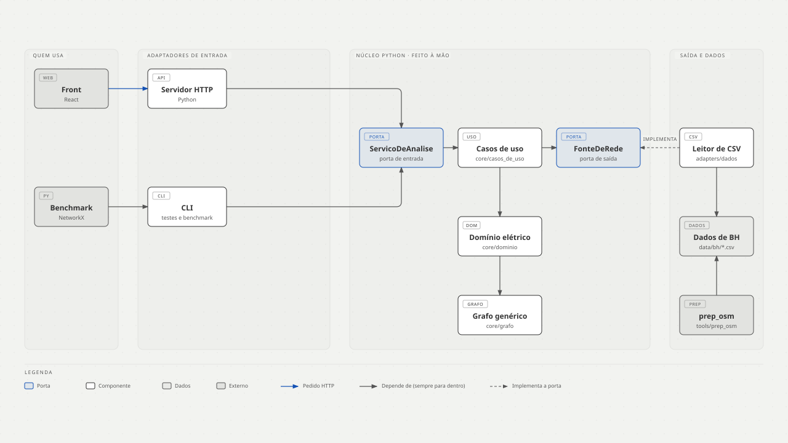
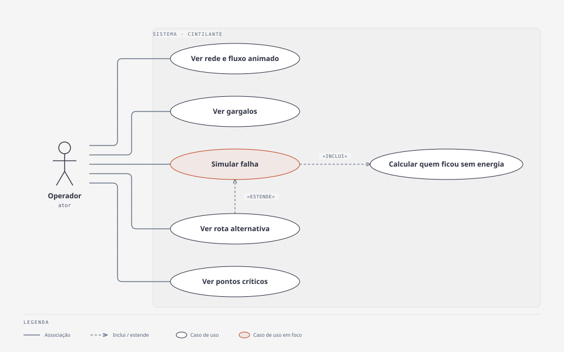

<div align="center">

<picture>
  <source media="(prefers-color-scheme: dark)" srcset="docs/banner-dark.gif">
  
</picture>

<p>
  
  
  
  
  
</p>

A rede de distribuição de energia de **Belo Horizonte** simulada em um grafo, com **fluxo de energia**, **gargalos** e **pontos críticos**.

## 🚀 Como rodar

### 🐍 Núcleo e servidor

> 📦 Dependências: Python 3.12 ou mais novo.

```sh
python -m unittest discover -s tests -t .
python adapters/http/servidor.py
```

### 🗺️ Front

> 📦 Dependências: Node 22, npm 10 ou mais novo.

```sh
cd front
npm install
npm run dev
```

## 🏛️ Arquitetura hexagonal

<picture>
  <source media="(prefers-color-scheme: dark)" srcset="docs/diagramas/hexagono-dark.svg">
  
</picture>

## 🎯 Casos de uso

<picture>
  <source media="(prefers-color-scheme: dark)" srcset="docs/diagramas/casos-de-uso-dark.svg">
  
</picture>

---

Mais detalhes em [docs/spec/README.md](docs/spec/README.md).

</div>