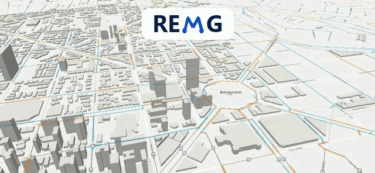

<div align="center">

<picture>
  <source media="(prefers-color-scheme: dark)" srcset="docs/banner-dark.gif">
  
</picture>

<br>

<p>
  
  
  
  
  
</p>

A rede de distribuição de energia de **Belo Horizonte** simulada em um grafo, com **fluxo de energia**, **gargalos** e **pontos críticos**.

</div>

## 🔗 Referências

- [Vídeo no YouTube](https://youtu.be/XknTZmISgS4)
- [Vídeo no Google Drive](https://drive.google.com/file/d/1kZfWUKoKRcz-UQVe7cYbcfVxxSwFGoO0/view?usp=sharing)
- [Relatório (PDF)](docs/relatorio/relatorio.pdf)
- [Slides da apresentação (PPTX)](docs/apresentacao/Apresenta%C3%A7%C3%A3o.pptx)

> 📊 A Tabela 5 do relatório vem de uma rodada do benchmark no Windows (Python 3.13.14, 22/11/2026). Os arquivos em `tools/benchmark/resultados/` são de outra rodada, no Linux (Python 3.13.18, 22/11/2026): os tempos mudam com a máquina, e as respostas são as mesmas nas duas, iguais às do NetworkX em todos os casos que terminaram.

## 🚀 Como rodar

### 🐍 Núcleo e servidor

> 📦 Dependências: Python 3.12 ou mais novo.

```sh
python -m unittest discover -s tests -t .
python adapters/http/servidor.py
```

### 💻 CLI

> Roda um algoritmo do núcleo num grafo de arquivo e mostra o resultado e o tempo. É o que o benchmark usa.

```sh
python adapters/cli/main.py caminhos     grafo.txt 0     # Dijkstra: distância de 0 até cada vértice
python adapters/cli/main.py fluxo        grafo.txt 0 3   # Dinic: fluxo máximo de 0 a 3
python adapters/cli/main.py componentes  grafo.txt       # BFS: componente de cada vértice
python adapters/cli/main.py pontes       grafo.txt       # Tarjan: arestas que são pontes
python adapters/cli/main.py articulacoes grafo.txt       # Tarjan: pontos de articulação
python adapters/cli/main.py arvore       grafo.txt       # Kruskal: árvore geradora mínima
```

O `grafo.txt` é não direcionado: a primeira linha é o número de vértices e cada linha seguinte é `u v capacidade [peso]` (peso padrão 1). `#` começa um comentário. Com `--json`, a saída vira uma linha só, `{"resultado": …, "tempoMs": …}`.

### 🗺️ Front

> 📦 Dependências: Node 22, npm 10 ou mais novo.

```sh
cd front
npm install
npm run dev
```

## 🏛️ Arquitetura hexagonal

<picture>
  <source media="(prefers-color-scheme: dark)" srcset="docs/diagramas/hexagono-dark.svg">
  
</picture>

## 🎯 Casos de uso

<picture>
  <source media="(prefers-color-scheme: dark)" srcset="docs/diagramas/casos-de-uso-dark.svg">
  
</picture>

<div align="center">

Mais detalhes em [docs/spec/README.md](docs/spec/README.md).

</div>