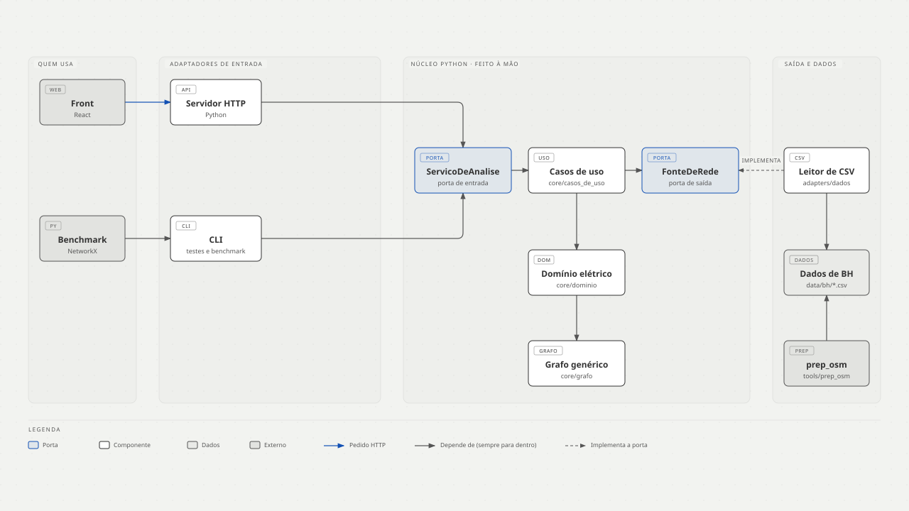

# 00 · 🔭 Visão geral

## 🎯 O problema

Uma rede de distribuição de energia leva eletricidade das **subestações** até os **consumidores** por cabos com **capacidade limitada**. As perguntas que a operadora faz todo dia são:

- 🌊 **Quanto de energia** consigo entregar, e por onde ela passa?
- 🚧 **Onde estão os gargalos**, ou seja, os cabos que limitam a entrega?
- 💥 **Se uma linha ou subestação cair**, quem fica sem luz?
- 🔀 **Como religar** quem ficou sem luz por outro caminho?

Essas quatro perguntas são problemas clássicos de grafos.

## 💡 A ideia

Um sistema que:

1. 🗺️ mostra o **mapa real de Belo Horizonte** (dados do OpenStreetMap);
2. ⚡ desenha por cima a **rede elétrica como grafo**: a alta tensão real do OSM e a distribuição gerada sobre as ruas;
3. 🎞️ **anima o fluxo** de energia nas arestas;
4. 🖱️ deixa o usuário **clicar para derrubar** uma linha ou subestação e ver, na hora, quem ficou sem energia e qual rota alternativa religa a área.

<picture>
  <source media="(prefers-color-scheme: dark)" srcset="../diagramas/hexagono-dark.svg">
  
</picture>

Detalhes em [05 · Arquitetura](05-arquitetura.md).

## 📏 Escopo em degraus

> [!IMPORTANT]
> São 13 dias até a entrega. O **essencial** precisa funcionar sozinho, mesmo que nada dos outros degraus fique pronto.

| Degrau | O que entra |
|---|---|
| 🟢 **Essencial** | BH inteira · alta tensão real + distribuição sintética · fluxo máximo animado · gargalos · simulação de falha · rota alternativa por chaves · benchmark contra o NetworkX · README escrito à mão por feature |
| 🟡 **Desejável** | pontos críticos sempre visíveis (pontes e articulações) · comparação Dinic × Edmonds-Karp no relatório · várias falhas ao mesmo tempo |
| 🔵 **Extra** | região metropolitana · expansão da rede com Kruskal (menor custo de cabo) · editar a rede pelo mapa |

## 🚫 Fora do escopo

- Física elétrica real: tensão, potência reativa, perdas, fluxo de carga AC. Aqui, **energia é um fluxo com capacidade**, e isso precisa estar dito no relatório como limitação.
- Dados reais de consumo por casa.
- Login, usuários, banco de dados.

## ❌ Seria um fracasso mesmo funcionando se…

- algum integrante **não souber explicar** como a própria feature funciona (por isso existe o README escrito à mão, ver [08-processo](08-processo.md));
- o grafo ou os algoritmos usarem **biblioteca pronta** (o PDF zera a nota);
- o uso de IA aparecer **escondido**;
- faltar **qualquer** item da entrega, porque a falta de um item zera a nota (ver [09-entregas](09-entregas.md)).

## 📜 Regras do PDF que guiam tudo

| Regra | Onde ela pesa |
|---|---|
| Grafo e algoritmos **sem bibliotecas prontas** (NetworkX só para comparar desempenho) | [04](04-algoritmos.md), [05](05-arquitetura.md) |
| Implementação em C/C++, Java ou Python | núcleo em Python ✅ (D26) |
| Front sem limite de framework | React + MapLibre ✅ |
| UML é avaliado | [03](03-modelagem.md) |
| Commits individuais são avaliados | [08](08-processo.md) |
| Demonstrar corretude, complexidade e limitações | [04](04-algoritmos.md) |
| Relatório SBC em LaTeX, 12 a 15 páginas · slides · apresentação de 10 min · vídeo de 12 a 18 min | [09](09-entregas.md) |
