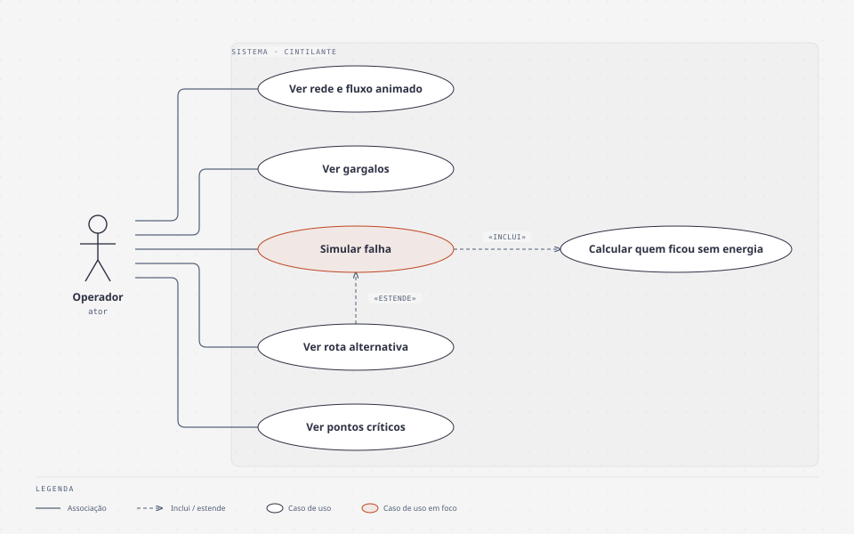
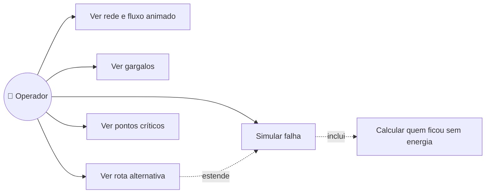
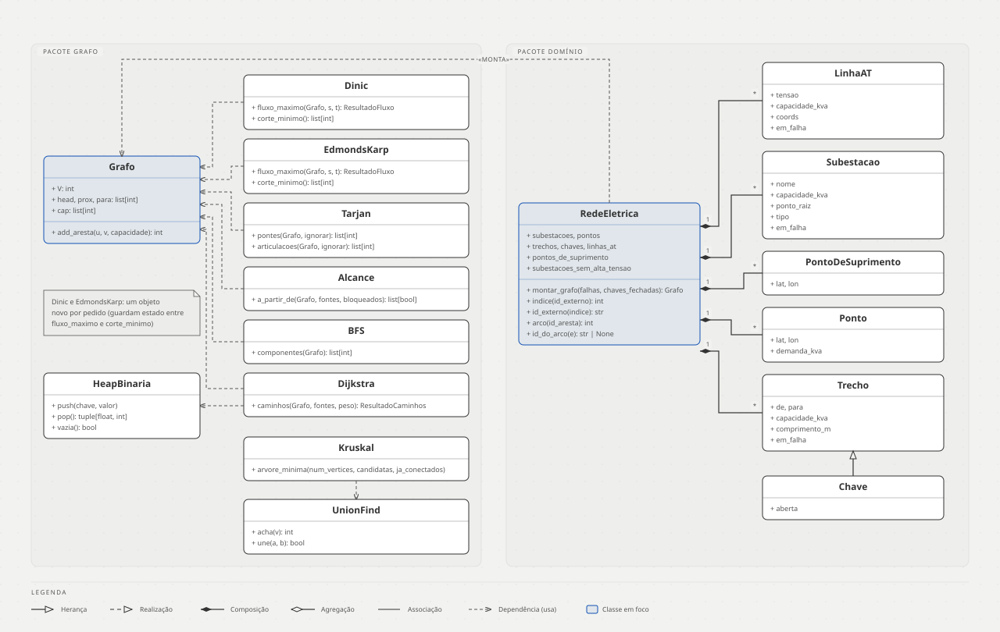
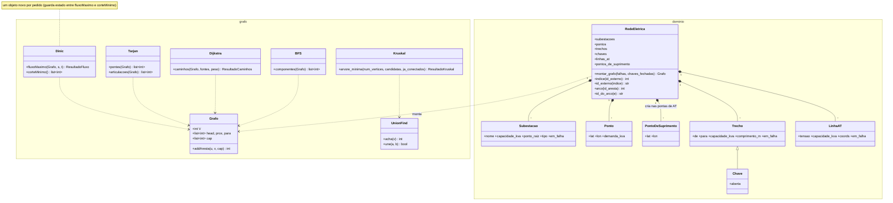
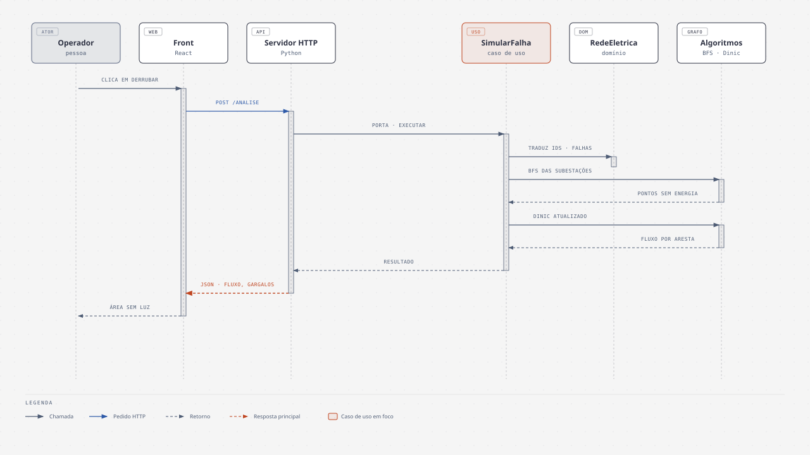
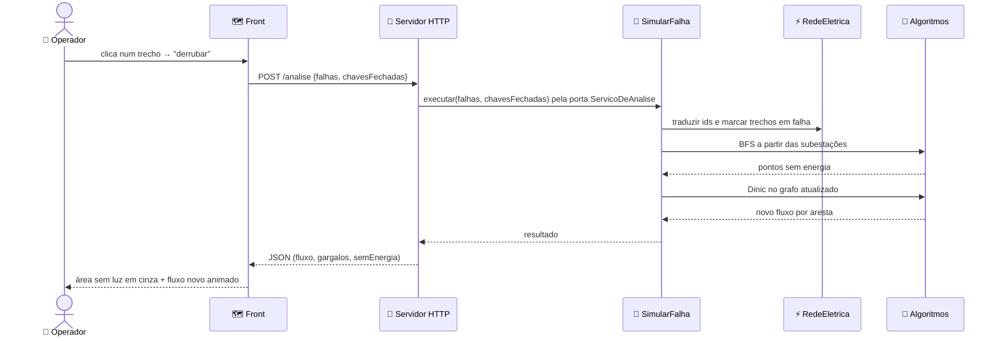
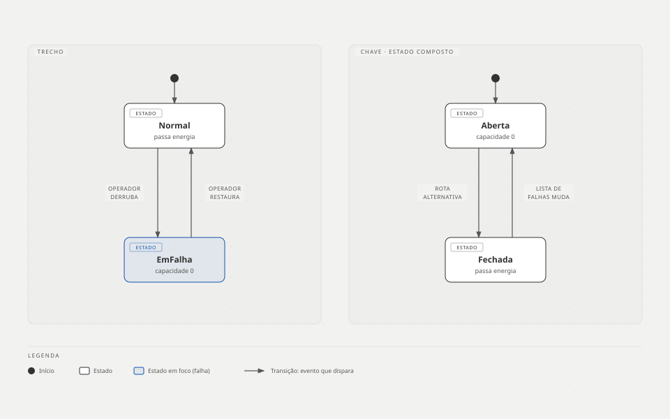
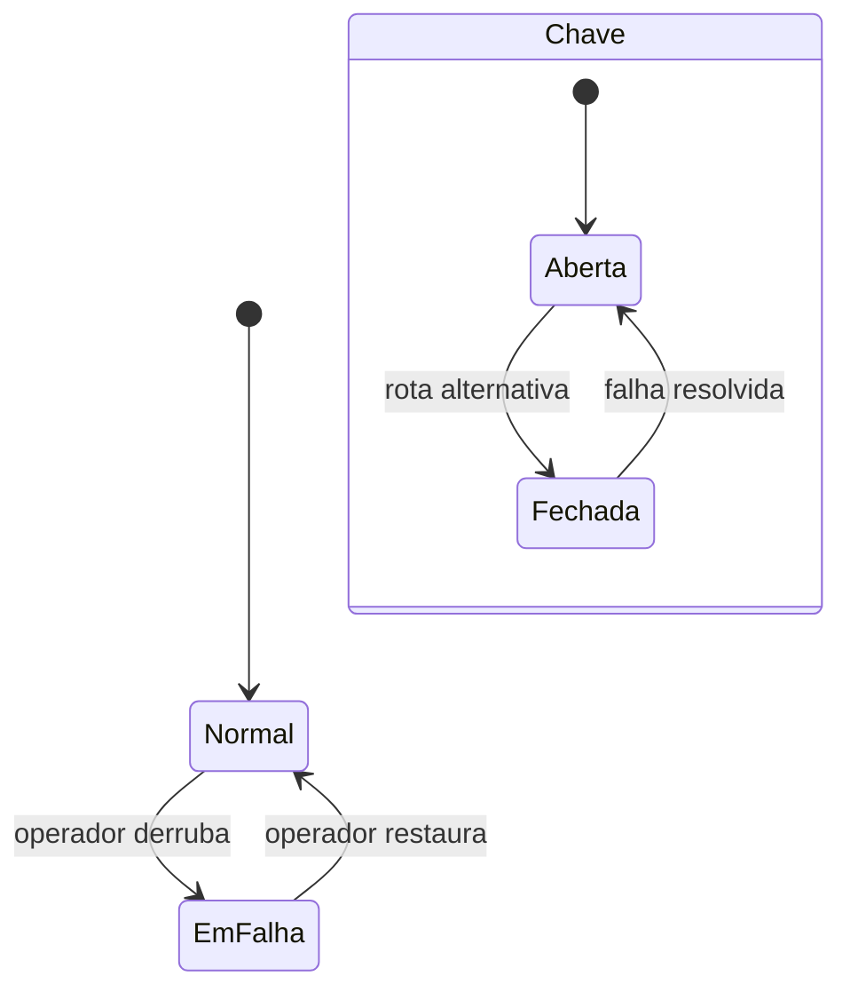

# 03 · 🧩 Modelagem do grafo

## 🔤 Glossário

| Termo | O que é |
|---|---|
| ⚡ **Subestação** | onde a energia entra na rede de distribuição. É uma **fonte** |
| 📍 **Ponto** | cruzamento ou ponta de rua por onde passa cabo. Pode ter **demanda** (consumidores ali) |
| 🔌 **Trecho** | cabo de distribuição entre dois pontos, com **capacidade** |
| 🗼 **Linha AT** | linha de alta tensão real (OSM) entre subestações |
| 🔘 **Chave de manobra** | trecho que liga áreas de subestações diferentes, **normalmente aberto**. Fechar a chave religa uma área |
| 🌳 **Alimentador** | árvore de trechos que sai de uma subestação |
| 🚧 **Gargalo** | trecho que limita a entrega (ver [04](04-algoritmos.md)) |
| 💥 **Falha** | trecho, linha ou subestação marcado como fora de operação |

## 🕸️ O grafo

| Parte | No grafo | Atributos |
|---|---|---|
| ⚡ Subestação | vértice | `capacidade` (kVA), `nome`, `tipo` |
| 📍 Ponto | vértice | `lat`, `lon`, `demanda` (kVA, pode ser 0) |
| 🔌 Trecho | aresta **não direcionada** | `capacidade` (kVA), `comprimento_m`, `estado` (normal/falha) |
| 🔘 Chave | aresta **não direcionada** | igual ao trecho + `aberta` (sim/não) |
| 🗼 Linha AT | aresta **não direcionada** | `tensao`, `capacidade` 🟡 |
| 🟣 Super-fonte **S** e super-sorvedouro **T** | vértices **virtuais**, só para o fluxo | S → pontos de suprimento da AT (cap. infinita) · cada ponto com demanda → T (cap. = demanda) |
| 🔻 Transformação da subestação | aresta subestação → ponto raiz do alimentador | cap. = capacidade da subestação (é ela que limita a subestação no fluxo) |

- ✅ **Unidade única de capacidade:** kVA.
- 🟡 **Ligação da alta tensão:** as pontas de linha AT que caem a menos de 200 m de uma subestação se ligam a ela. As linhas que cruzam a divisa de BH viram **pontos de suprimento** ligados a S.
- ✅ **Plano B, por subestação (#50):** a subestação que **não alcança nenhum ponto de suprimento** andando pelas linhas AT liga **direto em S**.
  - 🤔 **Por que existe:** o OSM não tem a alta tensão completa. Em BH, 5 das 18 subestações de distribuição (Centro, Carlos Prates, Serrano, Barro Preto e Calafate) não têm nenhuma linha AT a menos de 200 m. Sem o plano B, as áreas delas (8.569 pontos, 60.140 kVA) ficavam **apagadas sem falha nenhuma**, e derrubar uma delas não mudava nada no fluxo. Isso é falha do dado, não da rede real: na vida real toda subestação recebe alta tensão.
  - 🧩 **Pega dois casos:** a subestação sem linha AT nenhuma e a "ilha" de subestações ligadas entre si, mas sem nenhuma linha que venha de fora. Sem suprimento nenhum na cidade, todas ligam em S (era o plano B original, para a cidade toda).
  - ⚠️ **Limitação:** nessas subestações, derrubar linha AT não tem efeito, porque a energia delas vem direto de S. Nas outras, a linha AT continua sendo a única entrada, e derrubá-la apaga a área. As que usam o plano B ficam em `RedeEletrica.subestacoes_sem_alta_tensao`, para a tela e o relatório poderem mostrar.
- 🟡 **Chave aberta ou trecho em falha** = capacidade 0 nos cálculos. O trecho continua no grafo, mas não passa nada por ele.

### 🧱 Representação na memória (núcleo)

- **Lista de adjacência em vetores** (forward-star): `head[v]`, `prox[e]`, `para[e]`, `cap[e]`.
- Cada aresta não direcionada vira **2 arcos em par** (`e` e `e^1`), e o par também serve de aresta reversa no grafo residual do fluxo.
- Ids internos são inteiros `0..V-1`. O id do OSM fica num mapa à parte, só para entrada e saída.

## 📐 UML

> ✏️ Cada diagrama tem a fonte em Mermaid logo abaixo. Mudou? Gere o SVG de novo com a skill `diagram-design` (os arquivos ficam em [`docs/diagramas/`](../diagramas/)).

### Casos de uso

<picture>
  <source media="(prefers-color-scheme: dark)" srcset="../diagramas/casos-de-uso-dark.svg">
  
</picture>

✏️ Fonte editável (Mermaid)

### Classes (núcleo)

<picture>
  <source media="(prefers-color-scheme: dark)" srcset="../diagramas/classes-dark.svg">
  
</picture>

✏️ Fonte editável (Mermaid)

> 💡 A camada `grafo` **não conhece** nada de energia. Quem traduz subestação, chave e falha para vértices, arestas e capacidades é o `RedeEletrica`, que também guarda a tabela de ids (`"t:678"` ↔ número do grafo, D23). Os casos de uso e as portas estão em [05-arquitetura](05-arquitetura.md).

### Sequência: simular falha

<picture>
  <source media="(prefers-color-scheme: dark)" srcset="../diagramas/sequencia-simular-falha-dark.svg">
  
</picture>

✏️ Fonte editável (Mermaid)

### Estados de um trecho

<picture>
  <source media="(prefers-color-scheme: dark)" srcset="../diagramas/estados-trecho-dark.svg">
  
</picture>

✏️ Fonte editável (Mermaid)

