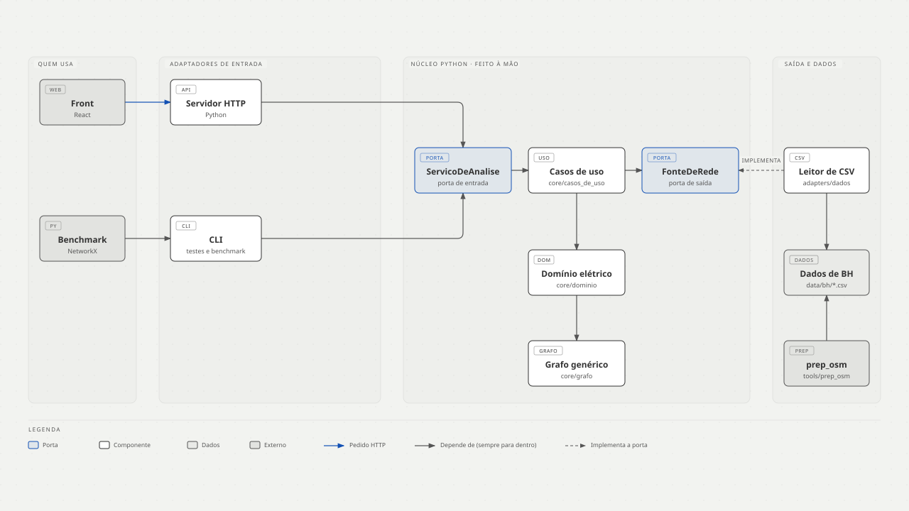
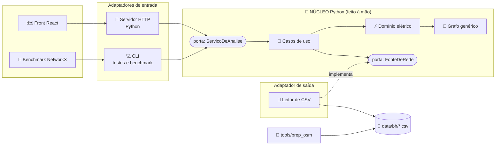

# 05 · 🏛️ Arquitetura

✅ **Hexagonal (portas e adaptadores).** O núcleo em Python (D26) guarda **todas as regras de negócio**. Servidor, linha de comando e leitura de arquivo são só **adaptadores**: trocam de lugar sem mexer no núcleo.

## 🔷 O hexágono

<picture>
  <source media="(prefers-color-scheme: dark)" srcset="../diagramas/hexagono-dark.svg">
  
</picture>

<details>
<summary>✏️ Fonte editável (Mermaid)</summary>

Mudou? Gere o SVG de novo com a skill `diagram-design` (ver [design](../superpowers/specs/2026-11-10-diagrama-hexagono-design.md)).



</details>

## 🧱 Camadas do núcleo

| Camada | Conhece | **Não** conhece | Exemplos |
|---|---|---|---|
| 🧮 **Grafo genérico** | vértices, arestas, capacidades | energia, HTTP, arquivos | `Grafo`, `Dinic`, `Tarjan`, `Dijkstra`, `BFS`, `HeapBinaria` |
| ⚡ **Domínio elétrico** | subestação, trecho, chave, falha, regra de gargalo, tabela de ids (`"t:678"` ↔ número do grafo) | HTTP, arquivos | `RedeEletrica`, `Subestacao`, `Trecho`, `Chave` |
| 🎯 **Casos de uso** | o domínio e as portas | como chega o pedido e de onde vem o dado | `CalcularFluxo`, `SimularFalha`, `RotaAlternativa`, `PontosCriticos`, `GerarRedeSintetica` |
| 🔌 **Portas** | só a assinatura | a implementação | `ServicoDeAnalise` (entrada), `FonteDeRede` (saída) |

> [!IMPORTANT]
> **As setas só apontam para dentro.** Grafo não importa domínio. Domínio não importa adaptador. Se um `import` aponta para fora, está no lugar errado.

✅ **Só duas portas.** Cada porta é uma classe `abc.ABC` com métodos `@abstractmethod`. Não há framework de injeção: o ponto de montagem de cada adaptador monta as peças na mão.

✅ **Adaptador só fala com o núcleo pela porta.** Servidor e CLI chamam só a `ServicoDeAnalise`. A única exceção é o ponto de montagem (`adapters/http/servidor.py` e `adapters/cli/main.py`), que cria os casos de uso e o leitor de CSV.

✅ **Servidor e núcleo no mesmo processo Python** (D26). O servidor importa o núcleo direto, sem módulo compilado. A rede fica na memória, a análise inicial roda uma vez ao ligar, e cada pedido vai direto ao núcleo (~3 s em BH inteira).

## 📚 O que pode usar biblioteca

| Parte | Biblioteca? |
|---|---|
| 🧮 Grafo e algoritmos | ❌ **nunca**, nem `heapq` nem `queue.PriorityQueue` ✅. `list`, `dict` e `collections.deque` podem |
| ⚡ Domínio e 🎯 casos de uso | ❌ só os módulos de `MODULOS_PERMITIDOS` (`collections`, `dataclasses`, `abc`, `typing`, `math`, `enum`, `itertools`, `functools`) |
| 🐍 Servidor · 📂 CSV · 💻 CLI | ✅ pode (framework HTTP do Python 🟡) |
| 🐍 `prep_osm` · benchmark | ✅ pode, exceto montar grafo (ver [02](02-dados.md)) |
| 🗺️ Front | ✅ sem limite |
| 🧪 Testes | ✅ `unittest` (biblioteca padrão) |

## 🔄 Estado no servidor

✅ **API sem estado.** O servidor carrega a rede de BH **uma vez** na memória. Cada pedido traz a lista completa de falhas e de chaves fechadas, e o núcleo calcula em cima de uma cópia das capacidades. Assim não há sessão nem risco de um usuário ver a falha do outro.

✅ **Cada pedido cria o próprio objeto de cálculo** (`Dinic`, BFS…). O servidor atende vários pedidos ao mesmo tempo, e esses objetos guardam estado entre `fluxoMaximo()` e `corteMinimo()`.

## 📁 Pastas do repositório 🟡

```text
luzes/
├── core/                  🐍 núcleo Python (feito à mão, pacote com __init__.py em cada camada)
│   ├── grafo/             🧮 Grafo, Dinic, Tarjan, Dijkstra, BFS, HeapBinaria
│   ├── dominio/           ⚡ RedeEletrica, Subestacao, Trecho, Chave
│   ├── casos_de_uso/      🎯 CalcularFluxo, SimularFalha, RotaAlternativa…
│   └── portas/            🔌 servico_de_analise.py, fonte_de_rede.py
├── adapters/
│   ├── http/              🐍 servidor HTTP em Python
│   ├── cli/               💻 linha de comando
│   └── dados/             📂 leitor dos CSV
├── tests/                 🧪 testes do núcleo (unittest, com __init__.py)
├── tools/
│   ├── prep_osm/          🐍 OSM → CSV
│   ├── benchmark/         🐍 núcleo × NetworkX
│   ├── verificar/         🛡️ confere commit e PR
│   └── kanban/            📋 docs/tasks → issues
├── data/bh/               📄 CSV processados (no git)
├── front/                 🗺️ React + MapLibre + deck.gl
├── .githooks/             ✍️ hook de mensagem de commit
├── .github/workflows/     ☁️ verificador no PR
├── AGENTS.md · CLAUDE.md  🤖 regras para IA
└── docs/
    ├── spec/              📚 esta spec
    ├── tasks/             📋 uma task por arquivo
    ├── diagramas/         📐 diagramas exportados
    ├── ia/                🤖 registro de uso de IA
    └── relatorio/         📑 LaTeX SBC
```

## ▶️ Como rodar (depois da T33)

- Sem compilar. Python 3.12 e mais nada para o núcleo.
- Testes do núcleo: `python -m unittest discover -s tests -t .`
- Servidor: `python adapters/http/servidor.py`
- Até a T33 fechar, o código que já existe ainda é C++: siga o README para compilar.
