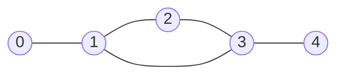
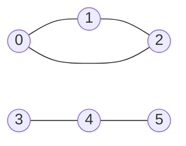
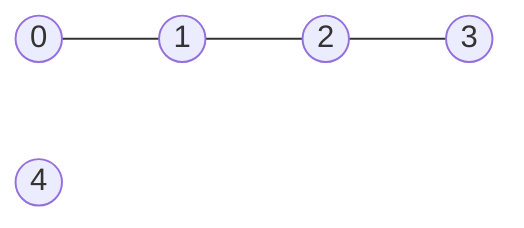

# 🧪 T07 · Grafos de teste da BFS (componentes conectados)

Grafos pequenos desenhados à mão para o teste [`tests/test_grafo_bfs.py`](../../tests/test_grafo_bfs.py). A resposta de cada um foi calculada no papel antes de rodar o código ([04 · Como provar que está certo](../spec/04-algoritmos.md#-como-provar-que-está-certo)).

> 💡 Os componentes são numerados na ordem em que a BFS os encontra: começa pelo vértice 0, e cada vértice ainda não visitado abre um componente novo.

## 1️⃣ Conexo

Um caminho 0–1–2–3–4 com um atalho 1–3 (que forma um ciclo). Dá para ir de qualquer vértice a qualquer outro.

| Vértice | 0 | 1 | 2 | 3 | 4 |
|---|---|---|---|---|---|
| Componente esperado | 0 | 0 | 0 | 0 | 0 |

✅ **1 componente.**

## 2️⃣ Desconexo

Um triângulo 0–1–2 e, separado dele, um caminho 3–4–5. Nenhuma aresta liga as duas partes.

| Vértice | 0 | 1 | 2 | 3 | 4 | 5 |
|---|---|---|---|---|---|---|
| Componente esperado | 0 | 0 | 0 | 1 | 1 | 1 |

✅ **2 componentes.**

## 3️⃣ Com vértice isolado

Um caminho 0–1–2–3 e o vértice 4 sem nenhuma aresta.

| Vértice | 0 | 1 | 2 | 3 | 4 |
|---|---|---|---|---|---|
| Componente esperado | 0 | 0 | 0 | 0 | 1 |

✅ **2 componentes**, e o vértice 4 fica sozinho no dele.

## ➕ Casos extras do teste

| Caso | Desenho | Esperado | Por quê |
|---|---|---|---|
| 🔘 Arco com capacidade 0 | 0 —5— 1 —**0**— 2 —5— 3 | `[0, 0, 1, 1]` | capacidade 0 = chave aberta ou trecho em falha ([03](../spec/03-modelagem.md)), então não liga nada |
| ⚪ Grafo sem arestas | 0 · 1 · 2 | `[0, 1, 2]` | cada vértice é um componente |
| ∅ Grafo vazio | — | `[]` | nada para visitar |
| 📏 Caminho com 200 mil vértices | 0 —1— 1 —1— … —1— 199999 | um componente só | a fila é um vetor com dois índices, sem recursão |
