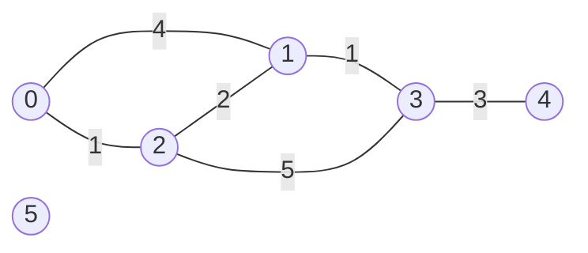
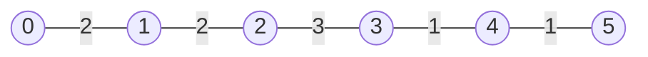

# 🧪 T08 · Grafos de teste do Dijkstra com várias fontes

Grafos pequenos desenhados à mão para o teste [`tests/test_heap_dijkstra.py`](../../tests/test_heap_dijkstra.cpp). A resposta de cada um foi calculada no papel antes de rodar o código ([04 · Como provar que está certo](../spec/04-algoritmos.md#-como-provar-que-está-certo)).

> 💡 O número na aresta é o **peso** (o comprimento da rua, por exemplo). As arestas não têm direção.

## 1️⃣ Grafo A · 1 fonte (vértice 0)

O caminho direto 0–1 custa 4, mas dar a volta por 2 custa 1 + 2 = 3. O vértice 5 não tem aresta nenhuma.

| Vértice | 0 | 1 | 2 | 3 | 4 | 5 |
|---|---|---|---|---|---|---|
| Distância esperada | 0 | 3 | 1 | 4 | 7 | ∞ |
| Pai esperado | — | 2 | 0 | 1 | 3 | — |

🔒 **Variação:** bloqueando a aresta 0–2 (peso ∞), as distâncias viram 0, 4, 6, 5, 8, ∞.

## 2️⃣ Grafo B · 2 fontes (vértices 0 e 5)

Um caminho com uma subestação em cada ponta. Cada vértice fica com a fonte mais perto pelas ruas, e a aresta 2–3, que liga as duas áreas, é a que viraria **chave aberta** na geração da rede.

| Vértice | 0 | 1 | 2 | 3 | 4 | 5 |
|---|---|---|---|---|---|---|
| Distância esperada | 0 | 2 | 4 | 2 | 1 | 0 |
| Fonte esperada | 0 | 0 | 0 | 5 | 5 | 5 |

## 3️⃣ Empate · 2 fontes (vértices 0 e 2)

Caminho 0–1–2 com peso 1 nas duas arestas. O vértice 1 está a 1 de cada fonte: fica com a **0**, que sai primeiro da heap (empate na chave → menor número).

| Vértice | 0 | 1 | 2 |
|---|---|---|---|
| Fonte esperada | 0 | 0 | 2 |
