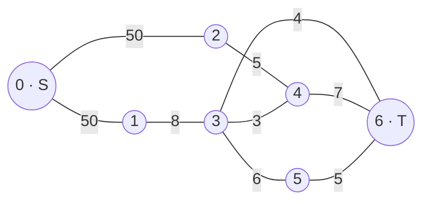
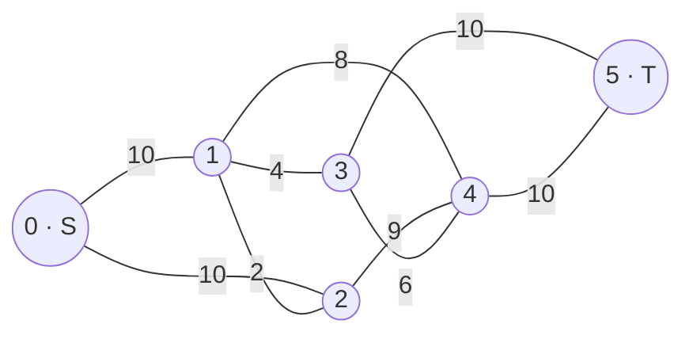
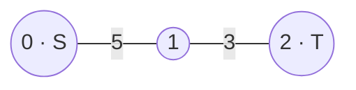
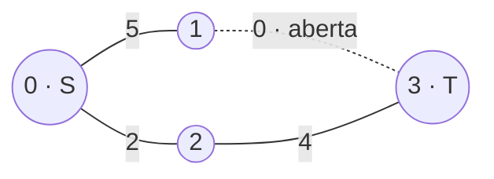
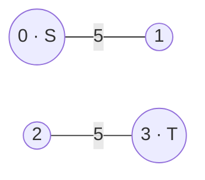

# 🧪 T09 · Grafos de teste do Dinic e do corte mínimo

Grafos pequenos desenhados à mão para o teste [`tests/test_dinic.py`](../../tests/test_dinic.py). A resposta de cada um foi calculada no papel antes de rodar o código ([04 · Como provar que está certo](../spec/04-algoritmos.md#-como-provar-que-está-certo)).

> 💡 As arestas são **não direcionadas** ([03](../spec/03-modelagem.md)): a capacidade vale para os dois sentidos, e o fluxo pode ir para qualquer lado. O número na aresta é a capacidade.
>
> 🚧 O corte que o código devolve é o **mais perto de S**: os vértices que S ainda alcança no grafo residual ficam de um lado, e o resto fica do outro.

## 1️⃣ Rede pequena (S → subestações → pontos → T)

`0` = S · `1` e `2` = subestações · `3`, `4`, `5` = pontos com demanda (4, 7 e 5) · `6` = T

**No papel:**
- Do lado das subestações só saem os trechos `1–3` (8) e `2–4` (5). Então **nada passa de 8 + 5 = 13**.
- Dá para chegar a 13: `1→3` leva 8 (4 ficam no ponto 3 e 4 seguem para o 5), e `2→4` leva 5.
- Os pontos pedem 4 + 7 + 5 = 16, então **3 de demanda ficam sem atender**.

| O quê | Esperado |
|---|---|
| Fluxo máximo | **13** |
| Fluxo em `0–1` · `0–2` | 8 · 5 (uso 0,16 · 0,10) |
| Fluxo em `1–3` · `2–4` | 8 · 5 (uso **1,0**, os dois cheios) |
| Lado de S no residual | `{0, 1, 2}` |
| 🚧 Corte mínimo | `1→3` e `2→4`, soma 8 + 5 = **13** ✅ |

## 2️⃣ O fluxo precisa atravessar o trecho do meio

**No papel:**
- Saem de S no máximo 10 + 10 = **20**, e chegam a T no máximo 10 + 10 = 20.
- O vértice 2 recebe 10, mas `2–4` só leva 9. **Pelo menos 1 tem que ir de 2 para 1** pelo trecho `1–2`.
- Um fluxo de 20: `0→1` 10 · `0→2` 10 · `2→1` 1 · `2→4` 9 · `1→3` 4 · `1→4` 7 · `4→3` 6 · `3→5` 10 · `4→5` 10.

| O quê | Esperado |
|---|---|
| Fluxo máximo | **20** |
| Fluxo em `1–2` | de 2 para 1 (negativo no sentido em que o arco foi criado) |
| Lado de S no residual | `{0}` (os dois trechos que saem de S estão cheios) |
| 🚧 Corte mínimo | `0→1` e `0→2`, soma **20** ✅ |

## 3️⃣ Aresta criada "ao contrário"

A aresta `1–0` foi criada no sentido 1 → 0, mas o fluxo vai de 0 para 1.

| O quê | Esperado |
|---|---|
| Fluxo máximo | **3** (limitado por `1–2`) |
| Fluxo no arco `1→0` | **−3** (e +3 no par `0→1`), uso 3 ÷ 5 = 0,6 |
| 🚧 Corte mínimo | `1→2`, soma **3** ✅ |

## 4️⃣ Chave aberta

O trecho `1–3` é uma chave aberta: capacidade 0 ([03](../spec/03-modelagem.md)).

| O quê | Esperado |
|---|---|
| Fluxo máximo | **2** (só o caminho `0–2–3`, limitado por `0–2`) |
| Fluxo na chave | 0, uso 0 |
| Lado de S no residual | `{0, 1}` |
| 🚧 Corte mínimo | só `0→2`, soma **2** ✅. A chave sai do lado de S, mas tem capacidade 0 e não conta como gargalo |

## 5️⃣ S e T sem ligação

✅ Fluxo **0** e corte **vazio**.

## ➕ Casos extras do teste

| Caso | Esperado | Por quê |
|---|---|---|
| ♾️ S ligada com `Dinic.INFINITO` | fluxo 11 e corte 11 | a super-fonte com capacidade gigante (10¹⁸) dá o mesmo resultado |
| 🔁 Rodar duas vezes no mesmo grafo | 6 e 6, e `g.cap` igual ao de antes | o Dinic trabalha numa cópia das capacidades ([05 · Estado no servidor](../spec/05-arquitetura.md#-estado-no-servidor)) |
| 📏 Caminho com 200 mil vértices | fluxo 1 e corte no trecho do meio | a DFS é iterativa; a recursiva estouraria a pilha |
| 🎲 200 grafos aleatórios (`random.Random(2026)`) | soma do corte = fluxo máximo | teorema do fluxo máximo e corte mínimo. O teste também confere que o fluxo respeita as capacidades, que o que entra num vértice sai dele e que tirar o corte separa S de T |
| 🚫 S ou T fora do grafo, S = T, corte antes do fluxo | exceção | entrada inválida |
