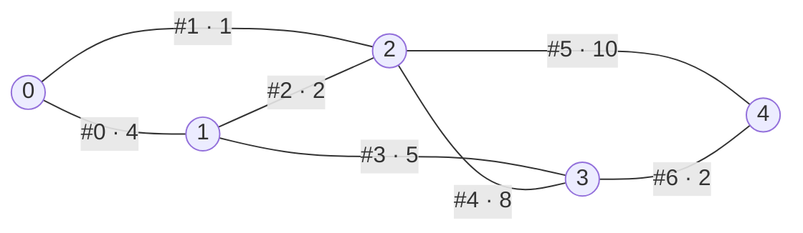
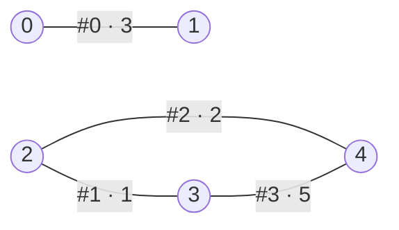
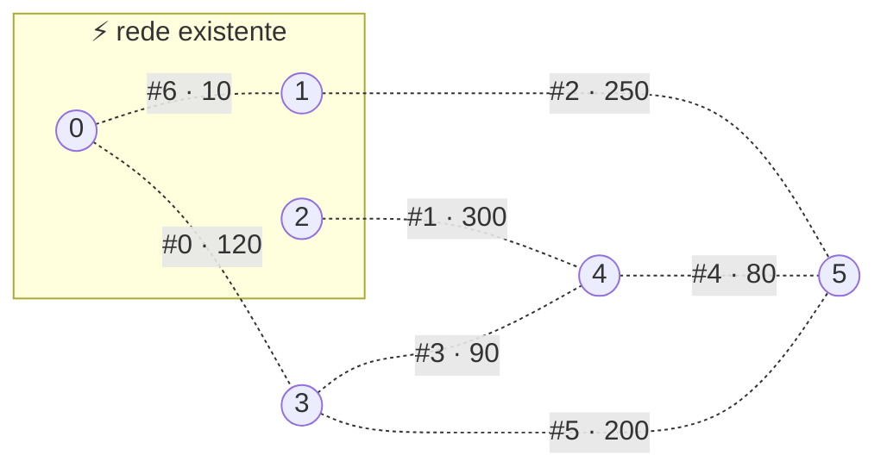

# 🧪 T30 · Grafos de teste do Kruskal

Grafos pequenos desenhados à mão para o teste [`tests/test_kruskal.py`](../../tests/test_kruskal.py). A resposta de cada um foi calculada no papel antes de rodar o código ([04 · Como provar que está certo](../spec/04-algoritmos.md#-como-provar-que-está-certo)).

> 💡 O número na aresta é o **custo** (metros de cabo). O Kruskal olha as arestas da mais barata para a mais cara e só aceita uma aresta se ela **não fecha ciclo**. As arestas são numeradas na ordem em que entram no teste (`#0`, `#1`…).

## 1️⃣ Conexo

**No papel**, em ordem de custo:

| Aresta | Custo | Decisão |
|---|---|---|
| #1 `0–2` | 1 | ✅ entra |
| #2 `1–2` | 2 | ✅ entra |
| #6 `3–4` | 2 | ✅ entra (empatou com a #2 e veio depois na entrada) |
| #0 `0–1` | 4 | ❌ fecha o ciclo 0–1–2 |
| #3 `1–3` | 5 | ✅ entra e liga as duas partes. Já são 4 arestas para 5 vértices, então acabou |

✅ Custo **10** (1 + 2 + 2 + 5), arestas `#1, #2, #6, #3`, **1** pedaço.

## 2️⃣ Desconexo (floresta)

| Aresta | Custo | Decisão |
|---|---|---|
| #1 `2–3` | 1 | ✅ |
| #2 `2–4` | 2 | ✅ |
| #0 `0–1` | 3 | ✅ |
| #3 `3–4` | 5 | ❌ fecha o ciclo 2–3–4 |

✅ Custo **6**, arestas `#1, #2, #0`, **2** pedaços (`{0, 1}` e `{2, 3, 4}`).

## 3️⃣ Ligar pontos novos à rede

`0`, `1` e `2` já fazem parte da rede (ligados entre si). `3`, `4` e `5` são pontos novos. As linhas pontilhadas são cabos que **poderiam** ser puxados.

| Aresta | Custo | Decisão |
|---|---|---|
| #6 `0–1` | 10 | ❌ 0 e 1 já estão ligados pela rede |
| #4 `4–5` | 80 | ✅ |
| #3 `3–4` | 90 | ✅ |
| #0 `0–3` | 120 | ✅ liga os pontos novos à rede. Tudo ligado, acabou |

✅ **290 m** de cabo (80 + 90 + 120), arestas `#4, #3, #0`, **1** pedaço.
💡 Ligar cada ponto novo direto na rede custaria 120 + 300 + 250 = **670 m**.

## ➕ Casos extras do teste

| Caso | Esperado | Por quê |
|---|---|---|
| 🟰 Três arestas de custo 5 num triângulo | `#0, #1`, custo 10 | empate: vale a ordem da entrada, então a resposta é sempre a mesma |
| 🔁 Laço `0–0` e duas arestas `0–1` (7 e 3) | só a de custo 3 | laço sempre fecha ciclo, e da repetida fica a mais barata |
| ∅ Sem vértices · sem candidatas | nada escolhido, 0 e 3 pedaços | cada vértice solto é um pedaço |
| 🎲 100 grafos completos aleatórios (`random.Random(2026)`) | mesmo custo que o Prim, n − 1 arestas | gabarito feito de outro jeito, dentro do teste |
| 🚫 Vértice fora do grafo · número de vértices negativo | exceção | entrada inválida |
| 🧩 Union-find | junta, diz quem já está junto e põe o menor conjunto embaixo do maior | é a peça que detecta o ciclo |

> ⏳ **Falta (T22):** comparar com o `networkx.minimum_spanning_tree` no benchmark. Com `ja_conectados` vazio, o resultado é a mesma árvore geradora mínima.
